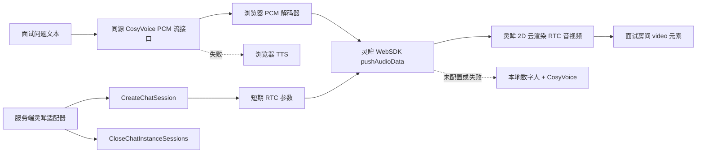

# 灵眸 2D 云渲染与 CosyVoice 接入设计

**日期：** 2026-07-17

**状态：** 已确认

**目标项目：** 开发面试数字人

## 1. 背景与已确认决策

当前面试房间已经具备候选人实时语音识别、服务端语音合成、本地数字人动画以及浏览器语音降级，但真实数字人画面仍未接入。现有推荐配置使用百炼 `avatar-dialog` 和 Qwen TTS，不符合本阶段选择的灵眸产品与 CosyVoice 语音方案。

本阶段采用以下已确认方案：

- 数字人：阿里云灵眸 2D 云渲染、音频驱动、WebSDK 接入。
- 语音模型：百炼 `cosyvoice-v3-flash`。
- 默认音色：`longanhuan`。
- 音频：48 kHz、单声道、PCM16。
- 当前外部条件：已有百炼 API Key，尚未创建灵眸项目，也没有灵眸配置 ID、实例 ID 或 RAM AccessKey。
- 开发策略：完整实现可配置适配层与自动化验证；灵眸未开通时明确降级，不冒充真实服务已可用。

## 2. 目标与非目标

### 2.1 目标

1. 用灵眸 2D 云渲染音频驱动数字人替换 `avatar-dialog` 推荐方案。
2. 用 CosyVoice 替换 Qwen TTS 推荐方案，并修正当前百炼 TTS HTTP 协议。
3. 让 CosyVoice PCM 音频通过灵眸 WebSDK `pushAudioData()` 驱动数字人口型。
4. 保持候选人摄像头、麦克风和现有 ASR 链路独立，不把候选人音频上传给灵眸 SDK。
5. 把永久凭据限制在服务端，并确保云端会话可靠关闭，避免持续占用付费并发。
6. 灵眸未配置或运行失败时，面试仍可通过本地数字人、CosyVoice 或浏览器 TTS 完成。

### 2.2 非目标

- 本阶段不创建或购买灵眸项目与实例。
- 本阶段不训练私有数字人形象或复刻音色。
- 本阶段不替换候选人语音识别模型。
- 本阶段不让灵眸接管面试 LLM、问题生成或报告分析。
- 没有真实灵眸参数时，不执行付费 RTC 会话或宣称真实联调通过。

## 3. 总体架构

百炼和灵眸使用两类独立服务商配置：

- `TONGYI`：保存百炼 API Key、Workspace ID 和地域，负责 ASR 与 CosyVoice。
- `LINGMOU`：保存灵眸 RAM AccessKey，负责创建和关闭实时数字人会话。

这样可以避免把百炼 API Key 与阿里云 RAM AccessKey 混为同一凭据，也可以独立启用、诊断和轮换。



## 4. 配置模型

### 4.1 百炼服务商

保留现有百炼配置：

- `apiKey`：通用百炼 API Key，加密存储。
- `ttsApiKey`：可选的 TTS 专用 Key，加密存储；存在时优先于通用 Key。
- `workspaceId`：百炼 Workspace ID。
- `region`：默认 `cn-beijing`。

### 4.2 CosyVoice 模型

`TEXT_TO_SPEECH` 的推荐与种子配置改为：

```json
{
  "modelName": "cosyvoice-v3-flash",
  "settings": {
    "voice": "longanhuan",
    "format": "pcm",
    "sampleRate": 48000,
    "channels": 1,
    "instruction": "你说话的情感是 neutral."
  }
}
```

模型名称和音色仍可在后台编辑，但运行时必须校验模型与音色组合。`longanhuan` 是 `cosyvoice-v3-flash` 的官方音色；默认指令使用官方要求的固定格式。

### 4.3 灵眸服务商

新增 `LINGMOU` 服务商类型：

- `accessKeyId`：RAM 用户 AccessKey ID，加密存储。
- `accessKeySecret`：RAM 用户 AccessKey Secret，加密存储。
- `region`：默认 `cn-beijing`。

RAM 用户只授予灵眸会话所需的最小权限，至少包含 `lingmou:CreateChatSession` 和关闭会话所需权限。浏览器、日志和数据库公开字段不得出现 AccessKey Secret。

### 4.4 灵眸数字人模型

`DIGITAL_HUMAN_REALTIME` 的推荐与种子配置改为：

```json
{
  "modelName": "lingmou-2d-cloud-audio-driven",
  "settings": {
    "configId": "",
    "instanceId": "",
    "renderMode": "cloud",
    "integrationMode": "audio-driven",
    "client": "web"
  }
}
```

`modelName` 是本项目中的适配器标识，不冒充阿里云推理模型 ID。云渲染模式不需要端渲染 License、App ID 或设备 ID。

## 5. 服务端组件

### 5.1 灵眸 OpenAPI 适配器

新增服务端适配器，职责限定为：

1. 解密并校验灵眸 RAM AccessKey。
2. 通过官方 `LingMou/2025-05-27` SDK 调用 `CreateChatSession`。
3. 验证配置 ID、实例 ID 和返回的 RTC 参数。
4. 把仅供当前浏览器入会的短期参数转换成公开 DTO。
5. 通过 `CloseChatInstanceSessions` 关闭会话。
6. 把阿里云错误映射为不含敏感信息的内部错误码。

服务端不自行签发 RTC Token，也不把 AccessKey、配置 ID 之外的永久凭据返回浏览器。

### 5.2 CosyVoice 适配器

现有 TTS 适配器从 Qwen 多模态生成接口迁移到官方 CosyVoice HTTP 接口：

`POST https://{workspaceId}.cn-beijing.maas.aliyuncs.com/api/v1/services/audio/tts/SpeechSynthesizer`

请求使用：

- `model: cosyvoice-v3-flash`
- `input.text`
- `input.voice: longanhuan`
- `input.format: pcm`
- `input.sample_rate: 48000`
- `input.instruction: 你说话的情感是 neutral.`
- `X-DashScope-SSE: enable`

适配器按顺序消费 SSE 中的 `sentence-synthesis` 音频块，校验 Base64、单块大小和总大小，解码后向下游输出原始 PCM 字节。API Key、上游 URL 和原始错误响应不会进入浏览器日志。

### 5.3 会话 API

新增以下同源接口：

- `POST /api/digital-human/sessions`
  - 输入训练会话 ID。
  - 验证训练会话仍在进行中。
  - 解析当前选中的 `DIGITAL_HUMAN_REALTIME` 配置。
  - 创建灵眸会话并返回短期 RTC 初始化参数。
- `POST /api/digital-human/sessions/:sessionId/speech`
  - 输入问题 ID 和文本。
  - 验证问题属于当前训练会话。
  - 以分块二进制响应转发 CosyVoice PCM。
  - 响应头声明 PCM16、48 kHz、单声道。
- `POST /api/digital-human/sessions/:sessionId/heartbeat`
  - 更新本地最后活动时间，不产生语音或数字人付费调用。
- `DELETE /api/digital-human/sessions/:sessionId`
  - 幂等关闭灵眸会话并记录停止原因。

所有响应使用 `Cache-Control: no-store`。接口继续接受项目现有后台认证保护，并校验训练会话归属和状态。

## 6. 会话生命周期与存储

新增 `DigitalHumanSession` 持久化记录：

- 本地会话 ID、训练会话 ID。
- 服务商、适配器标识、灵眸会话 ID。
- 状态：`CONNECTING`、`READY`、`SPEAKING`、`STOPPING`、`STOPPED`、`FAILED`。
- 创建时间、最后活动时间、过期时间、结束时间和非敏感停止原因。

不得存储：

- 百炼 API Key。
- 灵眸 AccessKey。
- RTC Token、nonce 或完整 RTC 参数。
- PCM 音频或合成音频文件。

进程启动时，无法恢复的非终态会话标记为 `FAILED`。空闲超时、页面退出、面试完成和进程关闭都必须尝试调用灵眸关闭接口。关闭操作幂等，重复请求不会重复占用或报错。

## 7. 浏览器组件

### 7.1 灵眸客户端封装

新增小型客户端封装并按需引入 `lm-avatar-chat-sdk/cloud`：

- 只在浏览器初始化 SDK。
- 使用 `tap2talk` 模式。
- 启动时显式设置 48 kHz 输出采样率，与 CosyVoice PCM 配置保持一致。
- 设置 `ignoreAudioInput: true`，避免 SDK 请求或上传候选人麦克风。
- 挂载到稳定的 `<video>` 元素。
- 监听首帧、可播报、状态变化和错误事件。
- 暴露 `start`、`pushPcm`、`interrupt` 和幂等 `exit`。

客户端 PCM 解码器处理网络任意分块边界，保证只把完整的小端 PCM16 样本转换成 `Int16Array`。最后一块调用 `pushAudioData(chunk, true)`；中间块使用 `false`。

### 7.2 面试房间行为

进入房间后才创建数字人会话，避免准备页占用灵眸并发。每个不可变问题 ID 只触发一次播报。切题、重播、退出或组件卸载会中断旧播报，防止两个问题同时发声。

候选人媒体仍由 `CandidateMediaPanel` 管理。灵眸客户端不请求麦克风和摄像头权限，避免与现有 ASR、录像和行为信号采集冲突。

## 8. 降级与错误展示

降级顺序如下：

1. 灵眸和 CosyVoice 可用：真实灵眸画面与 CosyVoice 音频。
2. 灵眸未配置或连接失败：本地数字人画面与真实 CosyVoice。
3. CosyVoice 失败：本地数字人画面与浏览器 TTS。
4. 浏览器 TTS 也不可用：保留题目文字和手动答题，不阻断面试。

若灵眸在播报中途失败，立即停止向 SDK 推送 PCM，切换本地画面并显示“数字人画面已降级”；不同时播放 RTC 音频和本地音频。用户可点击重播，在本地画面模式重新播放完整问题。

后台诊断状态必须区分：

- `NOT_CONFIGURED`：缺少配置 ID、实例 ID 或 AccessKey。
- `CONFIG_VALID`：本地字段和加密凭据完整，但未产生付费调用。
- `LIVE_AVAILABLE`：管理员明确触发真实检查且成功。
- `LIVE_FAILED`：真实检查失败，仅返回安全错误码。

当前本机状态应显示灵眸 `NOT_CONFIGURED`，不能显示适配器可用或连接成功。

## 9. 安全、成本与合规

- 灵眸 AccessKey 使用 RAM 子账号和最小权限，不使用主账号长期密钥。
- 永久密钥只在服务端解密；前端只获取短期 RTC 参数。
- 真实灵眸检查可能占用计费并发，只能由管理员显式触发，并在创建后立即关闭。
- 页面退出和服务端终止都执行会话清理。
- 生产环境必须使用 HTTPS；本地仅使用 `localhost`，不以局域网 IP 代替安全上下文。
- 页面保留“AI 生成数字人”标识，为后续生成合成内容合规要求预留稳定展示位置。

## 10. 测试策略

### 10.1 自动化测试

- CosyVoice URL、请求体、SSE 顺序、Base64 校验、超时和重试。
- `cosyvoice-v3-flash` 与 `longanhuan` 的允许组合。
- 灵眸凭据解密、配置验证和 OpenAPI DTO 映射。
- 会话状态迁移、幂等关闭、空闲清理和进程重启恢复策略。
- API 鉴权、会话归属、短期参数输出和永久密钥不泄露。
- 浏览器 SDK 只按需加载、忽略麦克风、PCM 顺序、末块标记、切题中断和卸载退出。
- 灵眸未配置、灵眸失败、CosyVoice 失败和浏览器 TTS 不可用的降级路径。
- 数据库迁移兼容现有数据，并只迁移未被用户修改的种子模型。

### 10.2 构建与 Docker

每个实施阶段执行定向测试；阶段结束执行完整测试、TypeScript 检查和生产构建。最终重建 Docker 镜像，在不调用付费服务的测试配置下验证健康接口、迁移和镜像内代码同步，然后删除临时容器并关闭 Docker Desktop。

### 10.3 真实联调边界

取得灵眸配置 ID、实例 ID 和 RAM AccessKey 后，执行一次显式真实联调：创建会话、收到首帧、推送一段短 CosyVoice PCM、确认口型与声音、执行关闭并确认无活跃会话。在此之前，验收报告明确标记“外部灵眸真实联调待开通”，但不阻塞适配器、配置、降级和自动化测试交付。

## 11. 分阶段交付

1. CosyVoice 协议、推荐模型与配置迁移。
2. 灵眸服务商配置、会话模型和服务端 OpenAPI 适配器。
3. 会话 API、生命周期清理与诊断。
4. 灵眸 WebSDK、PCM 推送与面试房间降级。
5. 完整回归、生产构建、Docker 同步验证和文档更新。

每个阶段均先写失败测试，再实现最小代码，通过验证后单独提交并推送到现有 GitHub 分支。

## 12. 验收标准

- 后台推荐的语音模型是 `cosyvoice-v3-flash`，默认音色是 `longanhuan`。
- 后台推荐的实时数字人是灵眸 2D 云渲染音频驱动，不再是 `avatar-dialog`。
- 灵眸未配置时后台显示明确状态，面试房间继续使用本地画面和 CosyVoice。
- 配置完整时浏览器可以使用短期 RTC 参数初始化 WebSDK，永久凭据不出现在响应或日志中。
- CosyVoice PCM 按顺序驱动灵眸，切题和退出不会残留旧音频或云端会话。
- 候选人 ASR、摄像头、麦克风和现有面试/报告流程不受影响。
- 全量测试、类型检查、源码构建和 Docker 构建通过，Docker 在验证后关闭。

## 13. 官方资料

- [什么是通义万相数字人](https://help.aliyun.com/zh/avatar/avatar-application/product-overview/what-is-lingmou)
- [2D 数字人实时对话](https://help.aliyun.com/zh/avatar/avatar-application/user-guide/avatar-2dchat/)
- [云渲染音频驱动数字人实时对话](https://help.aliyun.com/zh/avatar/avatar-application/user-guide/cloud-rendering-powers-audio-driven-digital-humans-for-real-time-conversation)
- [万相数字人云渲染音频驱动 WebSDK](https://help.aliyun.com/zh/avatar/avatar-application/developer-reference/digital-people-conversation-cloud-render-audio-driver-websdk)
- [CreateChatSession](https://help.aliyun.com/zh/avatar/avatar-application/developer-reference/api-lingmou-2025-05-27-createchatsession)
- [CosyVoice HTTP API](https://help.aliyun.com/en/model-studio/cosyvoice-tts-http-api)
- [CosyVoice 音色列表](https://help.aliyun.com/en/model-studio/cosyvoice-voice-list)
